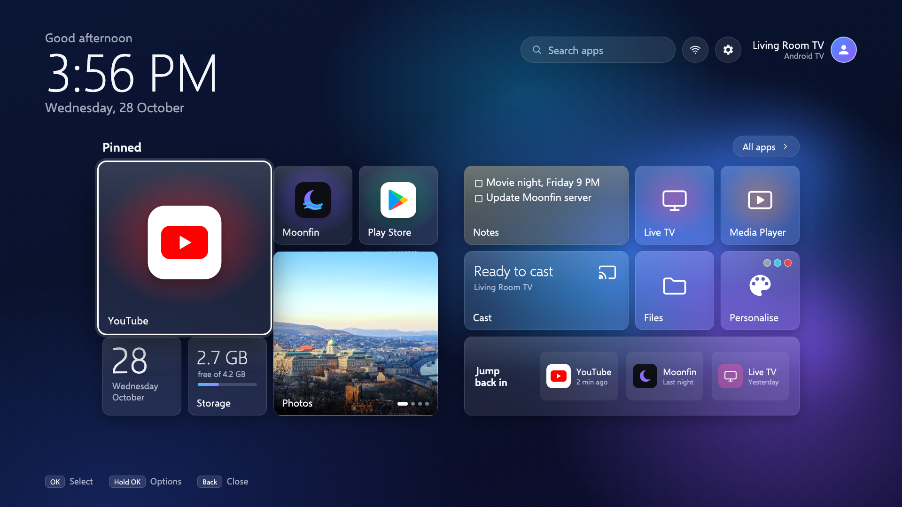

<div align="center">

# Vitrine

**A lightweight Android TV home launcher: fast, ad-free, no tracking.**
Plus a one-command kit to **add AirPlay to your TV** and a toolkit to **debloat and enhance your TV's performance**, all without root.


<sub>Vitrine's home screen design (1080p render). Live tiles in frosted glass over a soft bloom wallpaper.</sub>

</div>

---

Budget Android TVs and Google TVs ship with launchers full of ads, sponsored rows and background services that
eat the little RAM they have. **Vitrine** replaces the home screen with one calm screen of live tiles. It's a
**1.9 MB** app that uses about **27 MB of RAM**, has **no internet permission**, and is driven entirely by the remote.

On the two TVs it was built on, the full treatment (Vitrine + debloat + tweaks) took free RAM from **462 → 697 MB**
on a 1.3 GB TV and from **599 → 974 MB** on a 1.7 GB Google TV.

## Features

- **Live tiles:** big clock and greeting, calendar, storage meter, a notes tile you type into with the remote,
  a Photos tile (cycles the showroom photos many MediaTek/MStar TVs ship with), cast status, recently used apps.
- **Your apps first:** pin up to six apps as tiles, everything else one press away under *All apps*, plus
  **search as you type**.
- **Remote-first:** clean focus ring, hold OK (or Menu) for options: pin, unpin, app info, uninstall.
- **Wallpapers:** Bloom, Cyan, Red and Grey, painted on the TV once, so there's no blur cost.
- **Light by design:** Kotlin + Jetpack Compose, two libraries, no network access, no analytics, no ads.
- **Works on locked TVs:** an optional Home-button redirect makes Vitrine the home screen even where the stock
  launcher can't be replaced, or disable the stock launcher for the leanest setup.
- **Android 11+ TVs** (Android TV and Google TV), 32- or 64-bit.

## Install

1. On the TV: **Settings → Device Preferences → About**, press OK on *Build* seven times, then turn on
   **Developer options → USB debugging / Network debugging**. Note the TV's IP address.
2. On your computer (`brew install --cask android-platform-tools` on a Mac):
   ```bash
   adb connect 192.168.1.50          # your TV's IP; accept the prompt on the TV ("Always allow")
   adb install vitrine.apk           # from the Releases page
   ```
   Or build it yourself: `TV=192.168.1.50 ./build.sh` (needs JDK 17+ and the Android SDK).
3. Open **Vitrine** from the TV's app list to try it first.

### Make it your home screen

| Option | How | Trade-off |
|---|---|---|
| **Redirect** (keeps the stock launcher) | `adb shell settings put secure enabled_accessibility_services io.github.qbh21.vitrine/io.github.qbh21.vitrine.HomeRedirectService` and `adb shell settings put secure accessibility_enabled 1` | The stock launcher keeps running and flashes for a moment |
| **Replace** (leanest) | Android TV: `adb shell pm disable-user --user 0 com.google.android.tvlauncher`. Google TV: disable `com.google.android.apps.tv.launcherx` **and** `com.google.android.tungsten.setupwraith` (otherwise the setup wizard takes over the Home button) | Saves 30–145 MB of RAM; undo with `pm enable` |

## Add AirPlay to your TV

Your TV can show up in **Screen Mirroring** on any iPhone, iPad or Mac, invisibly and from boot, like Chromecast.
No app to open and no interface, just the video, and back to the home screen when you disconnect.

```bash
TV=192.168.1.50 NAME="Living Room TV" ./airplay/install-airplay.sh
```

It builds the open-source [android-airplay-server](https://github.com/jqssun/android-airplay-server) (UxPlay)
with a TV patch for your TV's chip. Details, settings and troubleshooting: [airplay/README.md](airplay/README.md).

## Debloat and enhance your TV's performance

Scripts that make removing bloatware safe and reversible (always `pm disable-user`, never uninstall, never touch
the firmware):

```bash
cd tools
TV=192.168.1.50 ./measure.sh baseline                       # snapshot: RAM, storage, packages, processes
TV=192.168.1.50 ./debloat.sh com.vendor.ads com.vendor.demo  # max 10 per batch, logged, refuses core/protected apps
adb -s 192.168.1.50:5555 reboot && TV=192.168.1.50 ./health.sh  # after every batch: home, Wi-Fi, inputs, cast, crashes
TV=192.168.1.50 ./tweaks.sh --apply                          # animations 0.5x, trim caches, close cached apps
TV=192.168.1.50 ./measure.sh after                           # compare with baseline
TV=192.168.1.50 ./debloat.sh --undo                          # everything back
```

What to disable and what never to touch, how to fix a soundbar that loses HDMI ARC, the "single video decoder"
trap that stops video in every app, and why you shouldn't unlock the bootloader:
**[docs/PLAYBOOK.md](docs/PLAYBOOK.md)**.

## FAQ

**Is this a Google TV launcher replacement?** Yes. It replaces both the Android TV and the Google TV home screen.

**Does it need root?** No. Everything uses standard ADB commands and can be undone, and a factory reset
always brings the TV back to day one.

**Will my apps still work?** Yes. Vitrine only replaces the home screen. YouTube, Netflix, Play Store, inputs and
Chromecast are untouched unless you choose to disable them.

**Which TVs?** Built and tested on budget 4K TVs with MediaTek/MStar chips (Android 11, 1.3–1.7 GB RAM). It
should run on any Android TV or Google TV on Android 11 or newer; please open an issue with your model.

## License

Vitrine is **MIT** licensed (see [LICENSE](LICENSE)). The Selawik fonts are © Microsoft, under the SIL Open Font
License 1.1 (`app/src/main/assets/Selawik-LICENSE.txt`). The AirPlay kit in `airplay/` modifies a GPL-3.0
project and is GPL-3.0 (see [airplay/LICENSE](airplay/LICENSE)).

<sub>Keywords: lightweight Android TV launcher, Android TV home screen, Google TV launcher alternative, ad-free TV
launcher, no-tracking launcher, debloat Android TV, speed up Android TV, enhance TV performance, add AirPlay to
Android TV, AirPlay receiver for Android TV, AirPlay on Google TV, low-RAM TV, MediaTek / MStar Android TV.</sub>
